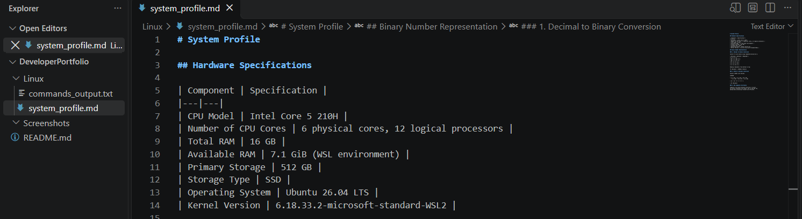
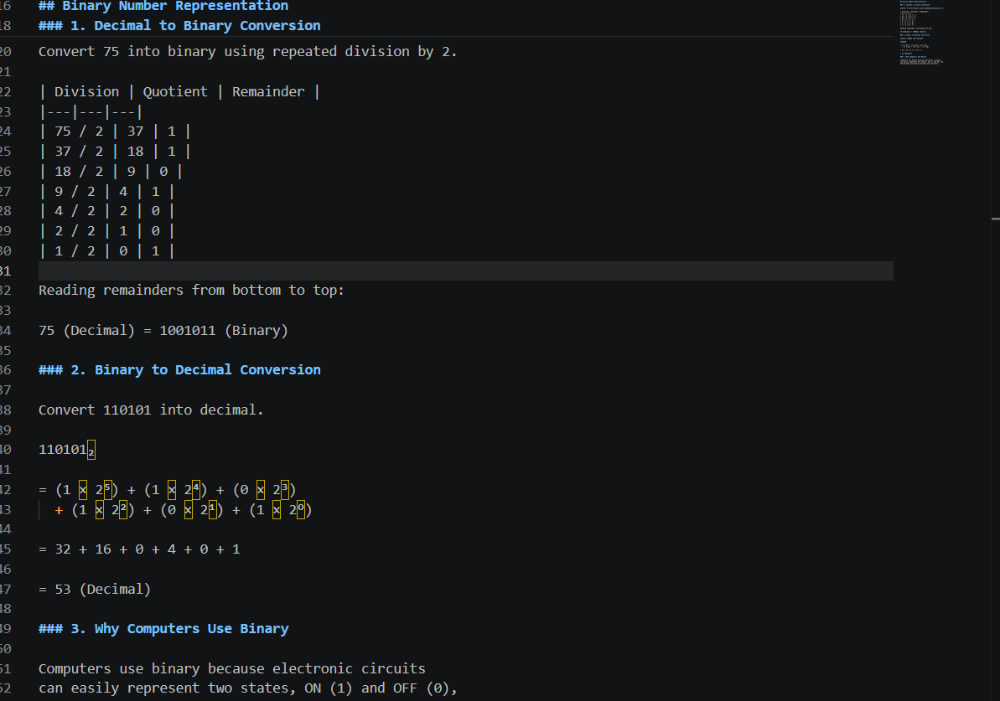
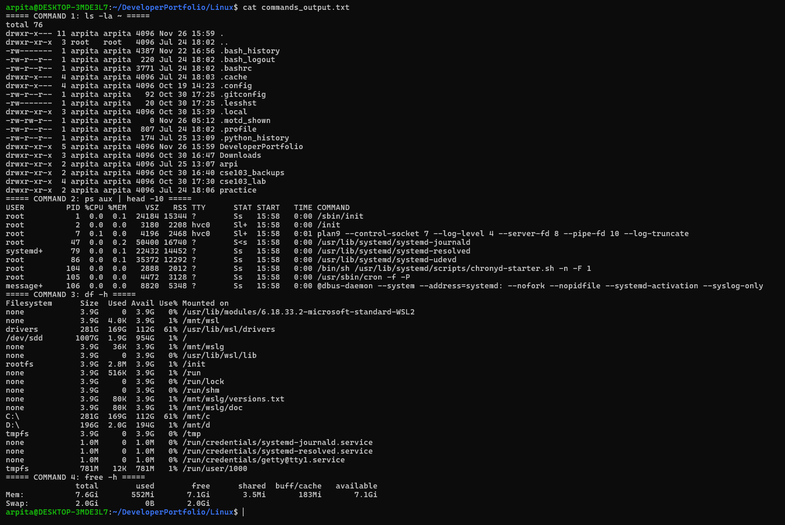

# DeveloperPortfolio

## Question 1: Linux Commands & System Documentation

### 1. System Profile
The system hardware specifications and operating system details are documented using Linux commands.

File: [system_profile.md](Linux/system_profile.md)

### 2. Binary Number Representation
Manual conversion of decimal 75 to binary and binary 110101 to decimal is documented in the system profile.

### 3. Linux Command Outputs
The following Linux commands were executed and their outputs were saved:

- `ls -la ~`
- `ps aux | head -10`
- `df -h`
- `free -h`

File: [commands_output.txt](Linux/commands_output.txt)

### 4. Screenshots

#### Hardware Information

#### Binary Conversion

#### Linux Command Outputs

